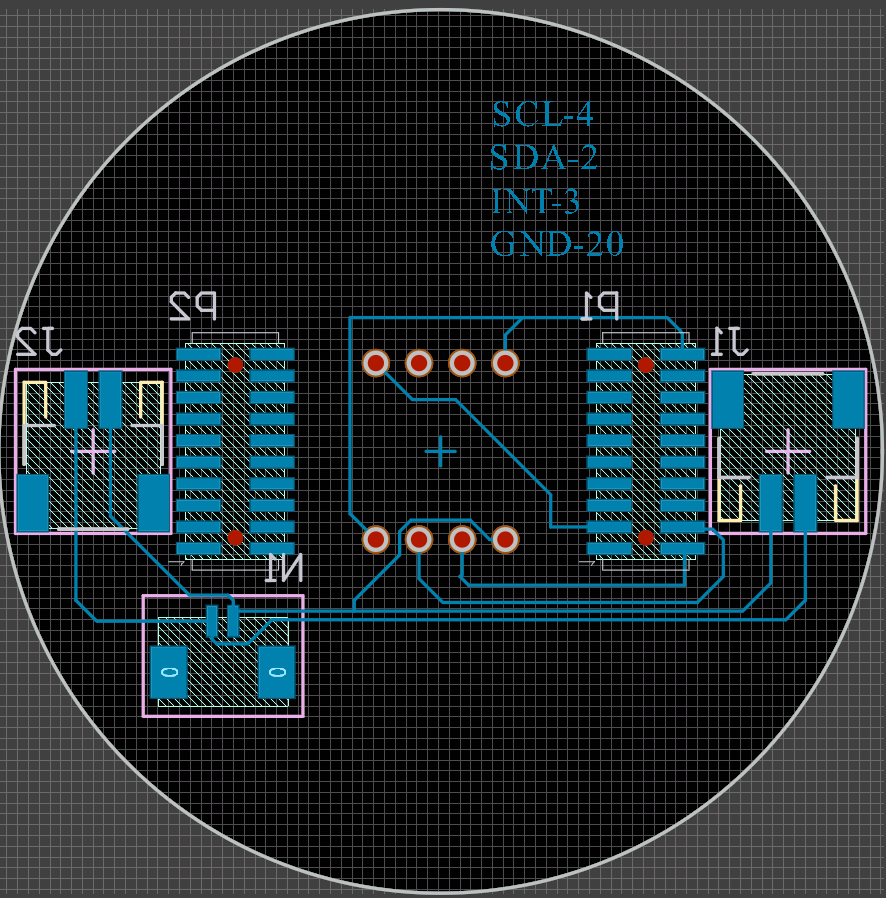
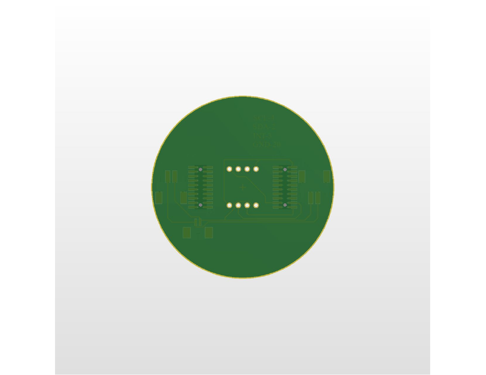
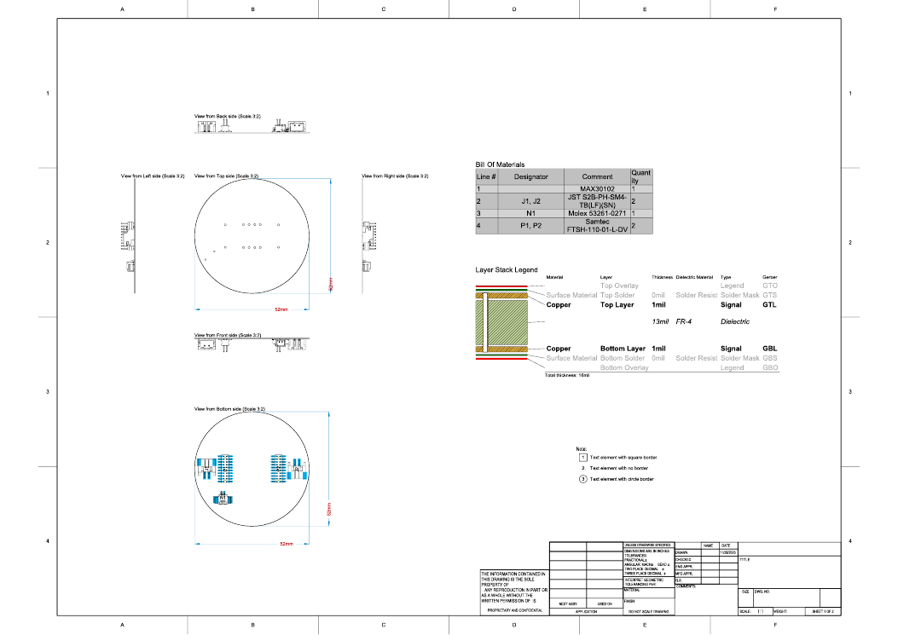

# Wearable PPG Sensor Board

A small round carrier PCB that connects a **MAX30102** pulse-oximetry / heart-rate (PPG) sensor module to a **Raspberry Pi Pico (RP2040)** over I2C, sized for a wrist- or chest-worn wearable.

Designed for the *Wearable Devices & Digital Health* course at National Taiwan University (Fall 2025). It was a group assignment; **I drew the schematic and the PCB layout myself.** The board was taken through to a full fabrication package but **has not been fabricated**.

| PCB layout | 3D view |
|---|---|
|  |  |

## Board at a glance

| Item | Value |
|---|---|
| Outline | Round, 52 mm diameter |
| Stack-up | 2 copper layers, FR-4 13 mil core, 1 mil copper, **16 mil (0.4 mm) total** -- thin for wearing on the body |
| Sensor | MAX30102 module (8-pin through-hole footprint) |
| Bus | I2C: SCL, SDA, plus the INT interrupt line and GND, routed to a 20-pin board-to-board header |
| Board-to-board | 2 x Samtec FTSH-110-01-L-DV (20-pin, 1.27 mm pitch) to the Raspberry Pi Pico side |
| Power | 2 x JST S2B-PH-SM4-TB, 1 x Molex 53261-0271 |
| Tool | Altium Designer |

### Bill of materials

| # | Designator | Part | Qty |
|---|---|---|---|
| 1 | -- | MAX30102 sensor module | 1 |
| 2 | J1, J2 | JST S2B-PH-SM4-TB(LF)(SN) | 2 |
| 3 | N1 | Molex 53261-0271 | 1 |
| 4 | P1, P2 | Samtec FTSH-110-01-L-DV | 2 |

## Fabrication package

Everything a board house needs is in [`fabrication/`](fabrication):

| Folder | Contents |
|---|---|
| `fabrication/gerber/` | Copper, solder mask, paste, silkscreen, outline and mechanical layers (Gerber RS-274X) |
| `fabrication/drill/` | Excellon NC drill file and drill report (8 plated holes for the sensor module, 4 non-plated alignment holes) |
| `fabrication/odb/` | ODB++ archive |
| `3d/PCB1.step` | STEP model for checking fit in an enclosure |
| `docs/fabrication_drawing.pdf` | Fabrication drawing with dimensions, layer stack and BOM |

## What I would do next

- Order the boards and bring one up with the Pico: read the MAX30102 over I2C and check the PPG signal on a scope.
- Add mounting / strap features and check the STEP model against an enclosure.
- Iterate on placement once real signal quality is measured on the body.

## Credits

- PCB design and fabrication outputs: Kai-Chun Chang (course group assignment, PCB drawn by me).
- This README and the repository layout were prepared in October 2026 with help from an AI assistant (Claude); the design files are unchanged originals exported in November 2025.
